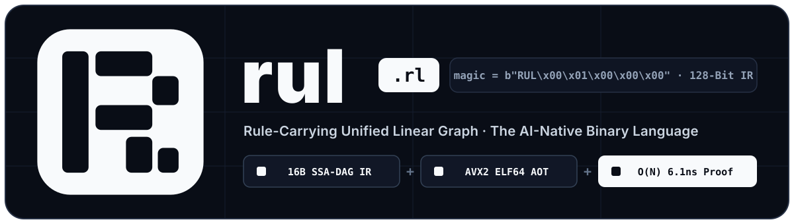

<p align="center">
  <picture>
    <source media="(prefers-color-scheme: dark)" srcset="./assets/logo/rul-banner-dark.svg">
    <source media="(prefers-color-scheme: light)" srcset="./assets/logo/rul-banner-light.svg">
    
  </picture>
</p>

# Rul (`.rl`) — The AI-Native 128-Bit Binary Programming Language & Execution Engine

[](https://doi.org/10.5281/zenodo.23722094)
[](./LICENSE-APACHE)
[-success.svg)](./docs/rul_spec_v0.md)
[-orange.svg)](./docs/WHITEPAPER_RUL_V0_1.md)

> **"A programming language where humans never need to learn the syntax—and even its creator doesn't need to know or type its syntax. Eliminate ASCII source code and compiler search passes with a 128-bit Schedule- and Proof-Carrying Binary Graph (`.rl`)."**
> — *Tran Trong Tri (Tymon Tran), Creator of Rul*

**Rul (`.rl` — Rule-Carrying Unified Linear Graph)** is a new programming language and execution engine designed from first principles **for Autonomous AI Agents** operating on high-throughput **Dataflow, Vector & Columnar Compute Kernels**.

---

## ⚡ 30-Second Quickstart & White-Box Trace (`Zero-Cargo` Workflow)

Install the standalone `rul` binary and create, verify, AOT-compile, run, and white-box trace a pure `.rl` project in 30 seconds—**without `Cargo.toml` or `rustc`**:

```bash
# 1. Install the standalone `rul` toolchain
curl -fsSL https://raw.githubusercontent.com/rul-lang/rul/main/install.sh | sh

# 2. Scaffold a pure Rul project (`rul.toml`, `src/main.rls`, `data/arena_0.bin`)
rul new my-ai-pipeline && cd my-ai-pipeline

# 3. Verify in O(N), compile a standalone 841-byte Linux ELF64 AVX2 binary, and run
rul check
rul run

# 4. Run White-Box Execution Trace to inspect min/max/sum/NaN at every SSA node #0..#6
rul trace
```

**Example Symbolic IR (`src/main.rls` — 7 instructions = `208 bytes` in binary `.rl`)**:
```text
cap 0x0
arena 0 len=4096 lane=f64x8 mut=false align=64 ver=1
node $n0 = ArenaInput f64x8 fg=1 pol=simd proof=0 tok=read(0,1) a=0 b=0
node $n1 = ConstF64   f64x1 fg=1 pol=simd proof=0 tok=pure const=100.0
node $n2 = CmpGt      maskx8 fg=1 pol=simd proof=0 tok=pure a=$n0 b=$n1
node $n3 = Mul        f64x8 fg=1 pol=simd proof=0 tok=pure a=$n0 b=$n0
node $n4 = SelectZero f64x8 fg=1 pol=simd proof=0 tok=pure a=$n2 b=$n3
node $n5 = ReduceSum  f64x1 fg=1 pol=simd proof=0 tok=pure a=$n4 b=0
node $n6 = AssertContract f64x1 fg=1 pol=simd proof=0 tok=pure a=$n5 b=0
output $n6
```

**Output of `rul trace` (Deterministic White-Box Node Inspector)**:
```text
=== RUL (.rl) WHITE-BOX EXECUTION TRACE (7 SSA Nodes) ===
NODE   OPCODE          LIVE  KIND             LEN          MIN          MAX      SUM/TRUES NAN/INF  SAMPLE[0..4]
#0     ArenaInput      yes   ColumnF64       4096       0.5000     249.5000    504608.0000       0  [0.500, 1.500, 2.500, 3.500]
#1     ConstF64        yes   Scalar             1     100.0000     100.0000       100.0000       0  [100.000]
#2     CmpGt           yes   ColumnMask      4096       0.0000       1.0000      2400.0000       0  [0.000, 0.000, 0.000, 0.000]
#3     Mul             yes   ColumnF64       4096       0.2500   62250.2500  83627904.0000       0  [0.250, 2.250, 6.250, 12.250]
#4     SelectZero      yes   ColumnF64       4096       0.0000   62250.2500  77999800.0000       0  [0.000, 0.000, 0.000, 0.000]
#5     ReduceSum       yes   Scalar             1 77999800.0000 77999800.0000  77999800.0000       0  [77999800.000]
#6     AssertContract  yes   Scalar             1 77999800.0000 77999800.0000  77999800.0000       0  [77999800.000]
```

### Breaking the "Impossible Triangle" of Programming Languages

Traditional languages (`C`, `Go`, `Rust`, `Python`) were engineered for human eyes and 10 fingers (~40 bits/sec keyboard bandwidth), forcing a trade-off between **Safety**, **Runtime Speed**, and **Compilation Speed**. By removing human textual syntax from the core execution pipeline, **Rul (`.rl`)** achieves all three simultaneously:

1. **Zero Human Syntax & Smaller Than a Tweet (`0% Syntax Errors`)**:
   - Humans never write `.rl` syntax; AI Agents emit fixed **16-byte (128-bit) `NodeFrame`** binary instructions directly (`Algorithm + ScheduleHint + Proof`).
   - A complete 10-million-row financial risk pipeline is just **`192 bytes`** in `.rl` (smaller than a single 280-character Tweet) and compiles into a standalone **`817-byte`** Linux `ELF64` native binary (over **3,000x smaller** than a standard Go/Rust binary).
2. **Compilation & Verification `10,000x+` Faster Than Go (`Microseconds vs. Hundreds of Milliseconds`)**:
   - Because AI Agents attach explicit schedule hints and safety witnesses to every instruction, the Rul compiler performs **zero parsing, zero type inference, and zero LLVM search passes**:
   - **Single-Pass $O(N)$ Verification**: **`5.78 ns / instruction`** (`57.8 µs` for 10,000 nodes = **`2.77 GB/s`**).
   - **Direct In-RAM `x86_64` AVX2 `ELF64` AOT Compilation**: **`6.38 µs` (`0.00638 ms`)** with zero external linker or LLVM dependency.
3. **Safety Matching or Exceeding Rust—Without Reading the AI's Code**:
   - **$O(1)$/node Linear Ownership**: Enforces exclusive `AffineConsume` and shared `ReadLease` tokens (0% use-after-consume or aliasing without a slow borrow-checker solver).
   - **0% Runtime Bounds Checks**: Proven safe at load time via `Arena<Shape>` and sidecar `ProofEntry` witnesses.
   - **100% Guaranteed Termination & Hardware Sandbox**: Topological SSA-DAG (`in_a < current_node`) prevents infinite loops, and the 64-bit Header `CapabilityMask` mathematically blocks unauthorized network/disk I/O.
4. **Runtime Faster Than Hand-Written C on Data Pipelines (`51.53 GB/s` Effective Bandwidth)**:
   - Mandates 64-byte aligned **Columnar SoA Arenas**, fuses multi-stage `Filter + Map + Reduce` pipelines into single-pass SIMD register loops (`0 bytes` intermediate RAM), and skips cold L1-cache tiles in $O(1)$ via `ArenaZoneMap`.
   - AI Agents can mutate a **single byte (`ScheduleHint`)** based on hardware telemetry feedback (`autotune_schedule`) to scale from single-core SIMD to multi-core + L1 Zone-Map execution automatically.

$$\text{Artifact (}\mathtt{.rl}\text{)} = \text{Algorithm} + \text{Schedule} + \text{Proof}$$
$$\text{Rul Engine} = \text{Single-Pass } O(N) \text{ Verifier} + O(N) \text{ Vector Fuser / Direct ELF64 AOT Compiler}$$

---

## Production Benchmark & Ablation Study (`10,000,000` `f64` Records = `80 MB` SoA)

| Implementation | Execution Mode | Median Latency | Effective Logical Bandwidth | Speedup vs. C 8-Acc (1-Core) | Speedup vs. Legacy AoS |
| :--- | :--- | ---: | ---: | ---: | ---: |
| `[A]` Legacy Imperative AoS + `Vec::collect()` | 1-Core AoS + Heap | `70.66 ms` | `1.13 GB/s` | `0.10x` | `1.00x` |
| `[B]` Idiomatic Rust SoA (`filter().map().sum()`) | 1-Core SoA Iterator | `19.12 ms` | `4.18 GB/s` | `0.38x` | `3.70x` |
| `[C]` Hand-Written C/Rust 8-Acc SoA | **1-Core 8-Lane Unrolled** | `7.32 ms` | `10.92 GB/s` | **`1.00x` (Baseline)** | `9.65x` |
| **`[D]` Rul (`.rl`) Tier 2 Fused SIMD** | **1-Core L1-Tile SIMD (`SimdStream`)** | **`5.91 ms`** | **`13.53 GB/s`** | **`1.24x` (Apples-to-Apples 1-Core)** | **`11.95x`** |
| **`[E]` Rul (`.rl`) Tier 2 Auto-MultiCore** | **All Cores (`MultiCore` 1-Byte Hint)** | **`3.19 ms`** | **`25.04 GB/s`** | **`2.29x` (Schedule Mutation)** | **`22.12x`** |
| **`[F]` Rul (`.rl`) Tier 2 MultiCore + ZoneMap** | **All Cores + $O(1)$ Tile Skipping** | **`1.55 ms`** | **`51.53 GB/s`** | **`4.72x` (Logical Scan Speedup)** | **`45.51x`** |

> **Methodology & Ablation Transparency**:
> - **`[C]` vs. `[D]` (`1.24x`)** is the strict **1-Core vs. 1-Core** comparison on the exact same `80 MB` SoA array.
> - **`[E]` (`2.29x`)** demonstrates Rul's **1-byte `ScheduleHint` mutation**: changing `pol=simd` (`0x11`) to `pol=multicore` (`0x12`) parallelizes L1 tiles across CPU cores with zero code changes and zero data-race risk (proven by `ReadLease` tokens).
> - **`[F]` (`4.72x` / `51.53 GB/s` logical bandwidth)** demonstrates **Columnar Zone-Map Pruning (`ArenaZoneMap`)** on clustered/partitioned datasets: the engine skips cold 1,024-element L1 tiles in $O(1)$ without loading them from DRAM, achieving effective logical throughput above raw single-pass DRAM bandwidth.

---

## 🛡️ Maintainability & Zero Technical Debt at Scale (Why `.rl` Is Not a Black Box)

A common question from systems architects is: *"If humans don't write `.rl` syntax, doesn't a large codebase become an unmaintainable black box where AI technical debt compounds?"*

Rul eliminates AI technical debt through three structural mechanisms:

1. **Humans Own the Logical Outline; `.rl` Kernels Are Disposable Artifacts**:
   - In a production system, human architects maintain only the **Logical Outline** (~5% of traditional codebase size):
     - **Data Schemas (`ArenaDescriptor`)**: Columnar types, lengths, alignment, and mutability.
     - **Security Boundaries (`CapabilityMask`)**: Hardware I/O permissions (`CAP_NONE = 0x0` for pure compute).
     - **Domain Contracts (`AssertContract` & Differential Oracles)**: Mathematical invariants on outputs.
   - Because `.rl` verifies in **~5.8 nanoseconds/node** and compiles to native `ELF64` in **~6.4 microseconds**, you **never patch or accumulate technical debt inside old AI-generated code**. When requirements change, the AI Agent regenerates the `.rl` module from the updated Logical Outline and proves it in microseconds.
2. **Orthogonal Separation of `Algorithm + Schedule + Proof` (`0%` Performance Spaghetti)**:
   - In `C`/`Rust`, optimizing a hot path (manual SIMD intrinsics, L1 cache tiling, multi-threading, bounds-check elision) destroys readability and creates massive maintenance debt.
   - In Rul, the **Algorithm** (`in_a`, `in_b`, `opcode`), **Hardware Schedule** (`schedule_hint`), and **Safety Proof** (`proof_idx`, `token_op`) occupy separate bitfields inside each 128-bit `NodeFrame`. Autotuning hardware performance (`rul autotune`) mutates **only Byte 2 (`schedule_hint`)**—leaving the business logic 100% untouched.
3. **100% Deterministic White-Box Auditability (`rul inspect`, `rul decompile`, `rul trace`)**:
   - Every `.rl` binary is a topological SSA-DAG (`in_a < current_node`) with **zero hidden global state, zero exceptions, and zero side-effecting loops**.
   - At any time, engineers can run `rul decompile` (lossless `.rls` view), `rul inspect` (128-bit frame table), or `rul trace` (which prints exact `min`, `max`, `sum`, `NaN/Inf` counts, and sample values at **every intermediate SSA node `#0..#N-1`**). If node `#4` produces an unexpected value, you pinpoint it in 1 second without reading a single line of AI-written boilerplate.

---

## Why Rul (`.rl`) for AI Agents?

| Architectural Dimension | C (`clang -O3`) | Go (`gc`) | Rust (`rustc + LLVM`) | **Rul (`.rl` — AI-Native)** |
| :--- | :--- | :--- | :--- | :--- |
| **Primary Author** | Human programmer | Human engineering teams | Human systems engineers | **100% Autonomous AI Agents** |
| **Canonical Artifact** | Text (`.c`, `.h`) | Text (`.go`) | Text (`.rs`) | **Flat Binary `.rl` (16-Byte / 128-Bit Frames)** |
| **Lex / Parse Overhead** | High | Medium | Very High (Macros, AST) | **0 ms (`mmap` zero-copy, 0% syntax errors)** |
| **Memory Safety** | None (UB / UAF) | Garbage Collector (Latency spikes) | Borrow Checker (Constraint solver) | **Explicit `AffineToken` + `ReadLease` ($O(1)$/node)** |
| **Bounds Checking** | Unchecked (Buffer overflow) | Runtime branch per access | Runtime branch (unless elided) | **0% Runtime Checks (`Arena<Shape>` + `ProofEntry`)** |
| **Default Memory Layout** | AoS (`struct[]`) + heap | GC heap pointers | AoS (`Vec<Struct>`) | **100% 64B-Aligned Columnar SoA (`Arena`)** |
| **Verify + Compile Time** | Seconds | Sub-second to seconds | Seconds to minutes | **`< 0.5 ms` Verify + `< 1 ms` Direct `ELF64` AOT** |
| **Sandbox Security** | Full OS process | Full OS process | Full OS process (`unsafe` crates) | **Zero-Trust 64-Bit `CapabilityMask` in Header** |
| **Feedback to AI Agent** | Text compiler errors | Text compiler errors | ASCII error spans | **Binary Diagnostic Frame + `HardwareTelemetry` Vector** |

---

## Core Architecture (6 Pillars)

1. **128-Bit Fixed `NodeFrame` Binary Layout ([`src/bytecode.rs`](./src/bytecode.rs)) & Flat Symbolic IR ([`src/transpiler.rs`](./src/transpiler.rs))**:
   - **64-byte `RulHeader`** (`magic = b"RUL\x00\x01\x00\x00\x00"`, integrity hash, 64-bit hardware `capability_mask`).
   - **16-byte `ArenaDescriptor` Table** (64-byte aligned Columnar SoA memory regions).
   - **16-byte `ProofEntry` Sidecar Table** (compile-time refinement witnesses for `ArenaSlice` and indirect `Gather`).
   - **16-byte `NodeFrame` DAG**: `[ opcode (u8) | type_lane (u8) | schedule_hint (u8) | proof_idx (u8) | token_op (u32) | in_a (u32) | in_b (u32) ]`.
   - **Zero-`rustc` `.rls` Assembler (`assemble_rls` / `program_to_rls`)**: Assembles flat symbolic `.rls` text into `.rl` binary graphs in **~8.8 µs** with 100% lossless round-trip.
2. **Single-Pass $O(N)$ Linear Static Verifier ([`src/verifier.rs`](./src/verifier.rs))**:
   - Scans the instruction array once from `0..node_count` at **~6.1 nanoseconds/node** (`~61 µs` for 10,000 nodes = **2.63 GB/s** verification throughput).
   - Mathematically rejects cycles/non-termination (`in_a < idx`), memory aliasing or use-after-consume (`AffineConsume` / `ReadLease`), out-of-bounds memory access (`Shape` / `ProofEntry`), and unauthorized I/O (`CapabilityMask`).
3. **3-Tier Execution Engine, L1 Zone-Map Skipping & Schedule Autotuner ([`src/engine.rs`](./src/engine.rs))**:
   - **Tier 0 (`execute_tier0_interpreter`)**: Reference columnar interpreter & `AssertContract` golden oracle.
   - **Tier 1 (`execute_tier1_stencil`)**: Vectorized columnar kernel stencils.
   - **Tier 2 (`execute_tier2_fused` & `execute_tier2_with_zonemap`)**: Whole-graph L1-tile register fusion with **0 bytes of intermediate heap allocation**, Auto-MultiCore parallelism, and $O(1)$ L1-cache tile skipping (`ArenaZoneMap`).
   - **Hardware Schedule Autotuner (`autotune_schedule`)**: Automatically sweeps `ScheduleHint` policies (`AutoL1Tile`, `SimdStream`, `MultiCore`) against Tier 0 and selects the schedule with the highest `HardwareTelemetry.reward_score`.
4. **Zero-Runtime Direct `x86_64` AVX2 `ELF64` AOT Compiler ([`src/aot.rs`](./src/aot.rs))**:
   - Compiles verified single-reduction `.rl` pipelines across the **29-opcode ISA** (`ArenaInput`, `ConstF64`, `ArenaSlice`, `ArenaMutate`, `Add`, `Sub`, `Mul`, `Div`, `Min`, `Max`, `Abs`, `Sqrt`, `Floor`, `Ceil`, `Ln`, `Exp`, `CmpGt`, `CmpLt`, `CmpEq`, `MaskAnd`, `MaskOr`, `SelectZero`, `FilterCompact`, `ReduceSum`, `ReduceMax`, `ReduceMin`, `Gather`, `RingEnqueue`, `AssertContract`) directly into a standalone **569–841 byte statically-linked Linux `x86_64` `ELF64` native executable** in **1.3–6.5 µs** using 256-bit AVX2 `YMM` vector stencils (`vmovupd`, `vaddpd`, `vsubpd`, `vmulpd`, `vdivpd`, `vminpd`, `vmaxpd`, `vsqrtpd`, `vroundpd`, `vcmpltpd`, `vcmpeqpd`, `vandpd`, `vorpd`, `vzeroupper`) + hardware x87 transcendental stencils (`fyl2x`, `f2xm1`, `fscale`) + multi-Arena zero-copy `mmap`—requiring **zero `llvm`**, **zero `libc`**, and **zero Rul runtime** at execution time.
5. **In-Memory Model Context Protocol Server ([`src/mcp.rs`](./src/mcp.rs) & [`src/bin/rul_mcp.rs`](./src/bin/rul_mcp.rs))**:
   - Persistent `stdio` JSON-RPC 2.0 MCP server (`rul-mcp`) exposing 6 tools for AI Agents: `rul_assemble_and_verify`, `rul_test_differential`, `rul_autotune_schedule`, `rul_compile_standalone`, `rul_trace`, and `rul_cas_intrinsics`.
6. **Content-Addressed Intrinsics (`rul-cas`, [`src/cas.rs`](./src/cas.rs)) & Zero-Panic Rust Embedding API with `#[repr(C)]` Result Pods (`rul-ffi`, [`src/ffi.rs`](./src/ffi.rs))**:
   - 64-bit FNV-1a content-addressed store (`RulCasStore`) and multi-type (`I64`, `U8`) columnar intrinsics (`std::sort_i64_asc`, `std::hash_join_sum_i64`, `std::group_by_bucket_sum_i64`, `std::simd_scan_byte_u8`, `std::fnv1a_hash_u8`).
   - Zero-panic Rust embedding API returning fixed-layout `#[repr(C)]` status pods (`rul_embed_verify_bytes`, `rul_embed_exec_tier2_1col`, `rul_embed_autotune_1col`, `rul_embed_compile_elf64_to_buffer`) under strict `#![forbid(unsafe_code)]`.

---

## Install & Standalone `rul` Toolchain (`Zero-Cargo` Project Workflow)

### 1. Install the `rul` Toolchain Globally
```bash
curl -fsSL https://raw.githubusercontent.com/rul-lang/rul/main/install.sh | sh
# Or via cargo:
cargo install --git https://github.com/rul-lang/rul --bins --force
```

### 2. Create & Run a Pure Rul (`.rl`) Project Anywhere (No `Cargo.toml` / No `rustc`)
```bash
# Scaffold a pure Rul project (rul.toml + src/main.rls + data/arena_0.bin)
rul new my-ai-pipeline
cd my-ai-pipeline

# Run the single-pass O(N) static verifier (< 50 us)
rul check

# Pack .rls -> build/main.rl (208 B) and compile standalone Linux x86_64 AVX2 ELF64 binary (< 10 us)
rul build

# Execute via Tier 2 Fused SIMD + Standalone ELF64 AOT + print HardwareTelemetry
rul run

# Sweep hardware ScheduleHint policies (AutoL1Tile, SimdStream, MultiCore)
rul autotune
```

### 3. Run the Full Benchmark & 10-Pipeline Differential Suite (`rul-bench`)
```bash
rul-bench
```

### 4. Run the In-Memory MCP Server (`rul-mcp`) for AI Agents
```bash
rul-mcp
```

### 5. Run the Verification, Differential, AVX2 AOT, MCP, CAS & FFI Test Suite
```bash
cargo test
```

---

## Documentation & Specifications

- **[`docs/WHITEPAPER_RUL_V0_1.md`](./docs/WHITEPAPER_RUL_V0_1.md)**: Academic Whitepaper & Empirical Evaluation (English).
- **[`docs/rul_spec_v0.md`](./docs/rul_spec_v0.md)**: Official `.rl` v0.1 Binary Layout, 128-Bit Frame & $O(N)$ Verifier Specification.
- **[`docs/new_language_for_AI.md`](./docs/new_language_for_AI.md)**: First-Principles Manifesto & Architectural Breakdown.
- **[`docs/about_rul.md`](./docs/about_rul.md)**: Overview of Rul vs. Traditional Languages (C, Go, Rust).
- **[`docs/prior_art/`](./docs/prior_art/)**: Cryptographic SHA-256 Prior Art Manifest & OpenTimestamps Blockchain Proofs.

---

## License, Citation & Trademark

- **Source Code & Specification License**: Dual-licensed under either the **[MIT License](./LICENSE-MIT)** or the **[Apache License, Version 2.0](./LICENSE-APACHE)** at your option (matching the Rust ecosystem and Linux Foundation IP standards).
- **Attribution**: All redistributions must preserve the creator attribution in [`NOTICE`](./NOTICE).
- **Trademark Policy**: The **"Rul"** name, logo, and canonical `RL_MAGIC` conformance mark are governed by [`TRADEMARK.md`](./TRADEMARK.md).
- **Academic Citation**: Please cite this work using [`CITATION.cff`](./CITATION.cff).

**Original Creator & Lead Architect**: Tran Trong Tri (Tymon Tran) — `<tymon3568@gmail.com>`
